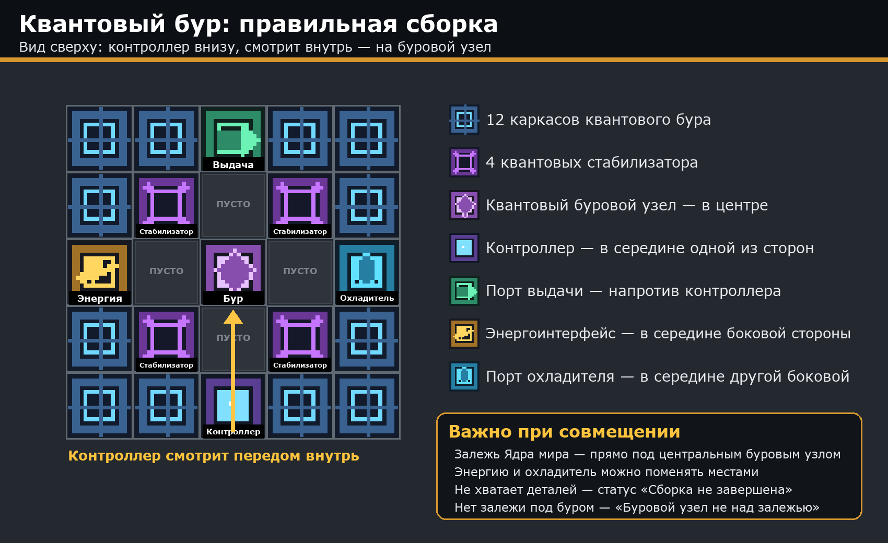

# OREBOUND — русский перевод

Неофициальный русификатор **OREBOUND 0.2.2** для **Minecraft 1.21.1 / NeoForge**. Версия перевода — 2.1.0.

Переведено заново, с учётом контекста и принятой в русском Minecraft терминологии:

- все квесты FTB Quests — 2330 строк, 38 глав, включая справочную главу «Помощь по добыче»;
- у заданий, которые засчитываются автоматически (в оригинале у них написано просто «Продвижение»), теперь есть понятное название и абзац «Как выполнить» — условия взяты из кода мода;
- основной мод сборки: языковой файл (869 строк) и текст, зашитый в код (524 строки) — главное меню, вступление, Полевое руководство, сюжетный архив из 30 записей, сообщения команд;
- 14 обучающих картинок в квестах;
- названия книг-руководств и стартовые таблички.

Названия блоков, предметов и мобов ванилы и других модов взяты из их официальных русских переводов. Термины самой сборки — в [глоссарии](docs/GLOSSARY.md).

### Установка на Windows

1. [Скачайте установщик](OREBOUND-RU.exe?raw=1) или скачайте и распакуйте ZIP репозитория.
2. Закройте Minecraft и запустите `OREBOUND-RU.exe`.
3. Выберите игровую папку сборки с каталогами `mods` и `config` (в Prism Launcher это вложенная папка `minecraft`) и нажмите **«Установить / обновить»**.

Русский язык включится автоматически. Новый мир создавать не нужно. Python и права администратора не требуются.

Версию 2.x можно обновлять поверх: установщик сам возьмёт оригинальный мод из своей резервной копии. Если раньше стояла версия перевода 1.x, сначала верните оригинальный `orebound-0.2.2.jar` — кнопкой **«Вернуть прежние файлы»** или переустановкой сборки.

### Откат

Нажмите **«Вернуть прежние файлы»** и выберите резервную копию из папки `orebound-ru-backups` внутри сборки. При откате табличек игровой прогресс сохраняется.

### Что не проверено

Установка проверена, все классы мода после изменения остаются корректными, но полного игрового прохождения с переводом не было: где-то текст может не помещаться в отведённое место. Интерфейс чата и миникарты на скриншотах в обучающих картинках оставлен как есть.

Моды и сохранения в пакет не входят. Как собрать пакет и установщик — в [src/BUILD.md](src/BUILD.md).

Сборка: [OREBOUND](https://www.curseforge.com/minecraft/modpacks/orebound-the-world-below).
